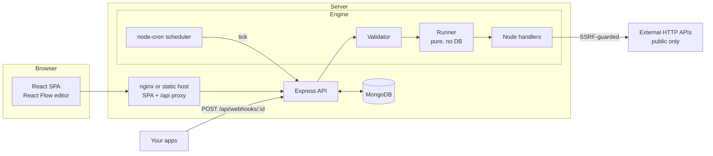

<div align="center">

# AutoLoom

### Weave your apps together. Connect · Automate · Execute.

A self-hosted, visual workflow-automation platform. Drag triggers, conditions and actions onto a canvas, and AutoLoom runs them for real: webhooks, schedules, HTTP calls, branching logic and a full execution history. Built with the MERN stack, in JavaScript only.

[Use cases](#use-cases) · [Features](#features) · [Quick start](#quick-start) · [Deploy](#deployment) · [API](#api-reference) · [Limitations](#known-limitations)

</div>

---

## What is AutoLoom?

Most "glue code" between apps is a pile of small scripts: *when X happens, check Y, then call Z*. AutoLoom lets you build that logic visually instead of writing and hosting a script for every case.

You connect nodes on a canvas:

```
Webhook ──▶ Condition: email contains "@acme.com" ──TRUE──▶ HTTP POST to your CRM ──▶ Log
                                                  └─FALSE─▶ Set variable "review" ──▶ Log
```

Every run is recorded node by node (inputs, outputs, timings, errors) so you can see exactly what happened and retry failures.

It is a self-hosted alternative in spirit to tools like Zapier or n8n, with a much smaller scope and its own implementation. You own the data and the server.

## Use cases

| Scenario | How you'd build it |
|---|---|
| **Customer sign-up routing** | Your app POSTs new registrations to a webhook. A condition checks the email domain or plan, then the workflow calls different internal APIs for company, partner or free users. |
| **API health monitoring** | A schedule trigger runs hourly, an HTTP node pings your endpoint, and a condition on `status` logs "healthy" or flags failures. Failed runs appear in the dashboard and notification bell. |
| **Lead & support ticket triage** | Incoming form/webhook payloads are routed by priority, country or keyword to different endpoints (Slack-compatible incoming webhooks, ticketing APIs, etc.). |
| **Data validation gate** | Validate payloads before accepting them: required fields exist, age or amount within range. Invalid data goes down a rejection path with a clear log. |
| **Scheduled data pulls** | Daily or weekly cron: call an API, store a value in a variable, forward it elsewhere. |
| **Webhook relay / fan-out** | Receive one event and forward reshaped JSON to several services, with retries on flaky targets. |
| **Prototyping automations** | Sketch and test a flow visually (with live test runs and per-node results) before turning it into production code. |
| **Learning & portfolio** | A complete reference for building a workflow engine: validation, safe interpolation, branching, scheduling, SSRF protection, tests. |

AutoLoom is a good fit for small teams, internal tooling, side projects and learning.

## Features

**Visual editor** (React Flow)
- Node library with drag & drop (or click to add), connect, move, delete, duplicate (`Ctrl/⌘ + D`), zoom, pan, fit-to-screen, minimap
- Right-hand configuration panel per node, with a reference of available variables
- Live validation (exactly one trigger, no cycles, everything connected, valid config) and a validity indicator
- Debounced autosave with *Saving / Saved / Save failed* status, plus a warning before leaving with unsaved changes
- **Test workflow** runs the real workflow and paints success/failure/skipped on each node

**Nodes**
| Type | Node | Notes |
|---|---|---|
| Trigger | Manual | Run on demand with a JSON test payload |
| Trigger | Webhook | Unique unguessable URL per workflow; captures headers, body, method, query, timestamp |
| Trigger | Schedule | Hourly, daily, weekly or custom cron (node-cron); only active workflows run |
| Logic | Condition | equals, not equals, contains, does not contain, greater than, less than, exists, is empty → **TRUE / FALSE** paths |
| Action | HTTP Request | GET/POST/PUT/PATCH/DELETE, headers, query params, JSON body, timeout, retries (0–3), optional saved integration |
| Action | Delay | 0–30 seconds |
| Action | Set Variable | Text, number, boolean or JSON |
| Action | Log Message | Writes to the run log |

**Engine**
- Safe `{{ }}` interpolation: `{{trigger.body.email}}`, `{{nodes.http_request_1.status}}`, `{{variables.customerName}}`. No `eval`, no user-supplied code execution
- Explicit branching, per-node results, failure tracking, runtime and node-count limits, cancellation, retry of failed runs
- Webhooks, schedules and manual runs all use the same engine

**Product**
- Dashboard with real statistics and Recharts (daily executions, success vs failed, workflow activity)
- Execution history with search, filters, pagination and a per-node timeline with JSON input/output
- Six ready-made templates (preview, then clone into an editable workflow)
- Integrations: reusable HTTP configs with none / bearer / API-key auth; secrets are AES-256-GCM encrypted and never returned by the API
- Account: register, login (JWT), profile, password change, workspace name, light/dark/system theme, execution defaults, account deletion

**Security**
- bcrypt password hashing, JWT auth, ownership checks on every query (other users' resources return 404)
- express-validator, Helmet, CORS, rate limiting, body-size limits, NoSQL-injection sanitising
- **SSRF protection** on the HTTP node: localhost, private ranges, link-local/cloud-metadata addresses and non-HTTP(S) schemes are blocked; resolved IPs are re-checked at connection time to resist DNS rebinding; redirects are not followed
- Secrets masked in execution history (e.g. `Authorization` headers)


## Tech stack

| Layer | Technology |
|---|---|
| Frontend | React 18, Vite, Tailwind CSS, React Router 6, `@xyflow/react` (React Flow), Axios, Context API, Recharts, Lucide |
| Backend | Node.js 20+, Express 4, MongoDB + Mongoose 8, JWT, bcryptjs, express-validator, node-cron, Axios, Helmet |
| Testing | Jest + Supertest (server), Vitest + React Testing Library (client) |
| Ops | Docker, Docker Compose, nginx, Postman collection, GitHub Actions CI |

## Architecture



```
autoloom/
├── client/     React app (components, pages, context, services, utils, routes, tests)
├── server/     Express app (controllers, models, middleware, routes, validators,
│               services/{workflowEngine,nodeHandlers,scheduler}, utils, tests)
├── postman/    AutoLoom.postman_collection.json
├── tests/      e2e-smoke.mjs (live-server smoke test)
├── docs/       DEPLOYMENT_AWS.md, screenshots/
└── docker-compose.yml · .env.example · IMPLEMENTATION_PLAN.md · TEST_REPORT.md
```

## How the engine works

1. **Validate**: exactly one trigger, known node types, real edges, no cycles, every node reachable from the trigger, per-node config rules.
2. **Create** an `Execution` (status `running`) and build a context `{ trigger, variables, nodes, execution }`.
3. **Traverse** breadth-first from the trigger. For each node: interpolate its config, run its handler, store its output at `nodes.<id>`, save the node result to MongoDB.
4. **Branch**: a Condition returns `true`/`false`; only edges whose `sourceHandle` matches are followed.
5. **Finish**: status becomes `success`, `failed` (with the failing node and message) or `cancelled`.

Webhooks: `POST /api/webhooks/:webhookId` → active webhook workflow → run → `200 {executionId,status}` or `422` with the failure message. Schedules: one in-memory node-cron job per active schedule workflow, replaced (never stacked) on every change.

Limits: 50 nodes per workflow, 50 node executions and 120 s per run, delay ≤ 30 s, HTTP timeout ≤ 30 s, retries ≤ 3, response ≤ 1 MB, webhook body ≤ 256 KB.

## Quick start

**Requirements:** Node.js 20+, MongoDB 6+ (local or [Atlas](https://www.mongodb.com/atlas)).

```bash
# 1. configure
cp .env.example server/.env        # Windows PowerShell: Copy-Item .env.example server\.env
# edit server/.env: set JWT_SECRET and ENCRYPTION_KEY (>= 32 chars)

# 2. API (terminal 1)
cd server
npm install
npm run dev                        # http://localhost:5000

# 3. UI (terminal 2)
cd client
npm install
npm run dev                        # http://localhost:5173
```

Generate secrets: `node -e "console.log(require('crypto').randomBytes(48).toString('hex'))"`

Open http://localhost:5173, register, and either create a workflow or clone a template.

### Docker

```bash
cp .env.example .env               # set JWT_SECRET and ENCRYPTION_KEY
docker compose up --build          # http://localhost:8080
```

## Environment variables

| Variable | Required | Default | Description |
|---|---|---|---|
| `JWT_SECRET` | yes | none | Signs login tokens |
| `ENCRYPTION_KEY` | yes | none | 32+ characters; encrypts integration secrets. Keep a backup |
| `MONGO_URI` | | `mongodb://127.0.0.1:27017/autoloom` | Database connection |
| `MONGO_URI_TEST` | | `…/autoloom_test` | Tests only (must contain "test") |
| `PORT` | | `5000` | API port |
| `JWT_EXPIRES_IN` | | `7d` | Token lifetime |
| `CLIENT_URL` | | `http://localhost:5173` | Allowed CORS origins (comma-separated) |
| `PUBLIC_API_URL` | | `http://localhost:5000` | Base URL shown in webhook URLs |
| `SCHEDULER_ENABLED` | | `true` | `false` disables cron on this instance |
| `VITE_API_URL` (client, build time) | | `/api` | Full API URL when the UI and API are on different hosts, e.g. `https://api.example.com/api` |

## Testing

```bash
cd server && npm test                       # Jest unit + Supertest integration (needs MongoDB; uses autoloom_test)
cd client && npm test                       # Vitest + React Testing Library
BASE_URL=http://localhost:5000 node tests/e2e-smoke.mjs   # live end-to-end smoke test
```

The repository's recorded results are in [`TEST_REPORT.md`](TEST_REPORT.md) (server 122/122, client 34/34, live smoke 23/23 at generation time). GitHub Actions (`.github/workflows/ci.yml`) runs the server and client suites and the client build on every push.

## API reference

All responses are JSON (`{ success, data | message, details? }`). Authenticated routes need `Authorization: Bearer <token>`. Import `postman/AutoLoom.postman_collection.json` to try everything.

| Method & path | Auth | Purpose |
|---|---|---|
| `POST /api/auth/register`, `POST /api/auth/login` | no | Create account / sign in |
| `GET /api/auth/me` | yes | Current user |
| `PUT /api/auth/profile`, `PUT /api/auth/password`, `DELETE /api/auth/account` | yes | Profile, password, delete account |
| `GET/POST /api/workflows` | yes | List (search, status, sort) / create |
| `GET/PUT/DELETE /api/workflows/:id` | yes | Read (with validation) / update / delete |
| `POST /api/workflows/:id/duplicate` | yes | Inactive copy with a new webhook id |
| `PATCH /api/workflows/:id/status` | yes | Activate / deactivate (validated) |
| `POST /api/workflows/:id/execute` | yes | Run now with `{ input }` |
| `GET /api/executions`, `GET /api/executions/:id` | yes | History and per-node detail |
| `POST /api/executions/:id/retry`, `/cancel` | yes | Retry failed / cancel running |
| `GET /api/templates`, `GET /:id`, `POST /:id/clone` | yes | Template library |
| `GET/POST /api/integrations`, `PUT/DELETE /:id` | yes | Reusable HTTP configs |
| `GET /api/dashboard/stats`, `/analytics?days=14` | yes | Real aggregates |
| `POST /api/webhooks/:webhookId` | secret URL | Trigger a workflow |
| `GET /api/health` | no | Liveness check |

Status codes: 400 validation · 401 auth · 404 not found (also for other users' resources) · 409 conflict or inactive · 413 too large · 422 invalid workflow / failed webhook run · 429 rate limited.

## Database design

- **User**: name, email (unique), password (bcrypt, hidden), workspaceName, theme, preferences, createdAt
- **Workflow**: userId, name, description, nodes[], edges[], status, triggerType, webhookId (unique), settings, timestamps
- **Execution**: userId, workflowId, workflowName (snapshot), status, triggerType, retryOf, input, nodeResults[], executionContext, logs, startedAt, completedAt, duration, error
- **Integration**: userId, name, type, configuration, encryptedCredentials (hidden), lastUsedAt
- **Template**: slug, name, description, category, nodes, edges, preview

## Known limitations

Please read before relying on AutoLoom:

- **Execution is sequential and in-process.** There is no queue or worker pool, and a webhook caller waits for the result (max 120 s).
- **Run one API instance.** Schedules live in memory; several replicas would each fire every schedule. A run interrupted by a restart is marked failed, not resumed.
- **Schedules use the server's timezone** (UTC in Docker by default).
- **No loops, no parallel-branch joins** (a node reached by several paths runs once).
- **HTTP node:** public destinations only, redirects not followed, 1 MB response cap, templated URLs are validated at run time.
- **No email/password reset or email notifications**, no teams/sharing, no workflow versioning.
- **Not battle-tested at scale**: it has automated tests (see `TEST_REPORT.md`), but treat it as a solid small-team/portfolio project, not a hardened enterprise platform.
- Docker/Compose and cloud deployment instructions were written but not executed by the authors of this scaffold; expect to troubleshoot your first deploy.

## Roadmap ideas

Loops and parallel joins · queue-backed workers · per-workflow versioning and rollback · more nodes (email, Slack, database) · OAuth integrations · team workspaces · timezone-aware schedules.

## Contributing

Issues and pull requests are welcome. Please run `npm test` in `server/` and `client/` before opening a PR.

## License

MIT, see [`LICENSE`](LICENSE).
